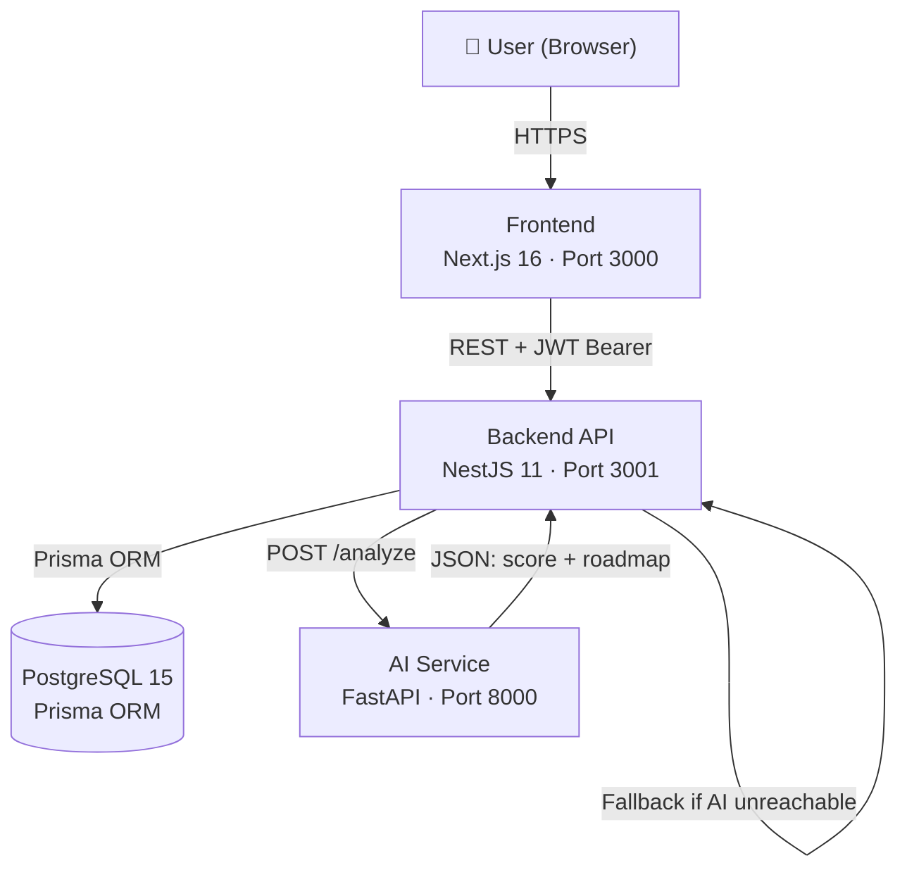

<div align="center">

# CareerForge AI

**An AI-powered career readiness platform that turns your resume into an actionable career strategy.**

[](https://nextjs.org/)
[](https://nestjs.com/)
[](https://fastapi.tiangolo.com/)
[](https://www.postgresql.org/)
[](https://docs.docker.com/compose/)

</div>

---

CareerForge AI helps developers understand where they stand relative to their target role. Upload a PDF resume, select a target tech role, and the platform extracts your skills, scores your readiness against real role requirements, identifies skill gaps, and generates a prioritised step-by-step learning roadmap — all powered by a custom NLP engine with intelligent fallback logic.

---

## ✨ Features

| Feature | Description |
|---|---|
| **PDF Resume Upload** | Drag-and-drop PDF upload with automatic text extraction |
| **Skill Extraction** | NLP keyword engine extracts 50+ technology skills from resume text |
| **Career Readiness Score** | Weighted percentage score comparing your skills against role requirements |
| **Skill Gap Detection** | Side-by-side view of matched skills vs. missing skills per target role |
| **Learning Roadmap** | Prioritised, step-by-step learning plan with curated resources and timelines |
| **Job Role Matching** | Supports 8 tech roles: Frontend, Backend, Full Stack, Data Scientist, DevOps, ML Engineer, Mobile, Cloud |
| **Interview Prep** | Role-specific interview preparation questions and guidance |
| **Multi-Theme System** | Multiple colour themes switchable by admin users |
| **JWT Authentication** | Secure registration and login with bcrypt password hashing |
| **Analysis History** | All analyses stored per user with full history on the dashboard |

---

## 🧠 AI Capabilities

The AI service is a **custom-built NLP skill extraction and analysis engine** — not a third-party AI API. It performs:

1. **Skill extraction** — flexible regex pattern matching against a dictionary of 30+ technology keywords, handling spacing, punctuation, and common variant names (e.g., `node.js` → `nodejs`, `react.js` → `react`)

2. **Role-based skill matching** — compares extracted skills against a role requirements database covering 8 tech roles using a normalisation-aware comparison (handles synonyms like `js`/`javascript`, `postgres`/`postgresql`)

3. **Readiness scoring** — calculates a weighted percentage: core skills for a role carry higher weight than supplementary skills

4. **Roadmap generation** — for each skill gap, produces a prioritised learning step with curated resource links (documentation, tutorials, courses)

5. **Graceful fallback** — if the AI service is unreachable, the backend runs the same algorithm locally, ensuring the application always produces a result

---

## 🏗️ Architecture

```
┌─────────────────────────────────────────────────────────────┐
│                        Browser                              │
│              Next.js 16 Frontend (Port 3000)                │
│     React 19 · TypeScript · Tailwind CSS · Axios           │
└───────────────────────┬─────────────────────────────────────┘
                        │ REST API + JWT Bearer
                        ▼
┌─────────────────────────────────────────────────────────────┐
│              NestJS 11 Backend (Port 3001)                  │
│     Auth · Resume · Analysis modules · Prisma ORM          │
└──────────────┬────────────────────┬────────────────────────┘
               │ Prisma ORM         │ HTTP POST /analyze
               ▼                    ▼
┌──────────────────────┐  ┌────────────────────────────────┐
│  PostgreSQL 15       │  │  FastAPI AI Service (Port 8000)│
│  4 tables:           │  │  Python · Uvicorn · Pydantic   │
│  User, Resume,       │  │  Skill extraction · Scoring    │
│  Analysis, Roadmap   │  │  Roadmap generation            │
└──────────────────────┘  └────────────────────────────────┘
```



---

## 🛠️ Tech Stack

### Frontend
- **Next.js 16** with App Router
- **React 19** + TypeScript
- **Tailwind CSS v4**
- **Axios** — API client with JWT interceptors
- **Recharts** — data visualisation
- **React Dropzone** — file upload

### Backend
- **NestJS 11** — modular Node.js framework
- **TypeScript**
- **Prisma 7** — ORM and database toolkit
- **passport-jwt** + **bcryptjs** — authentication
- **pdf-parse** — PDF text extraction
- **multer** — multipart file upload

### AI Service
- **Python 3**
- **FastAPI 0.115**
- **Uvicorn 0.30**
- **Pydantic v2**

### Database
- **PostgreSQL 15**

### Infrastructure
- **Docker** + **Docker Compose**
- **JWT** (Bearer tokens)

---

## 📂 Project Structure

```
careerforge-ai/
├── frontend/                 # Next.js 16 frontend
│   ├── app/
│   │   ├── auth/             # Login & registration page
│   │   ├── dashboard/        # Protected dashboard
│   │   │   ├── analysis/     # Analysis results
│   │   │   ├── interview/    # Interview preparation
│   │   │   ├── jobs/         # Job role matches
│   │   │   ├── roadmap/      # Learning roadmap
│   │   │   └── upload/       # Resume upload & analysis
│   │   ├── globals.css
│   │   ├── layout.tsx
│   │   └── page.tsx          # Landing page
│   ├── components/
│   │   ├── Navbar.tsx
│   │   └── ThemeProvider.tsx
│   ├── lib/
│   │   ├── api.ts            # Axios client with JWT interceptors
│   │   └── auth.ts           # localStorage auth helpers
│   └── .env.example
│
├── backend/                  # NestJS 11 API
│   ├── src/
│   │   ├── auth/             # Registration, login, JWT strategy
│   │   ├── resume/           # PDF upload, text extraction
│   │   ├── analysis/         # Career analysis, roadmap
│   │   └── prisma/           # Database service
│   ├── prisma/
│   │   ├── schema.prisma     # 4 models: User, Resume, Analysis, Roadmap
│   │   └── migrations/
│   └── .env.example
│
├── ai-service/               # Python FastAPI service
│   ├── main.py               # Skill extraction & analysis engine
│   └── requirements.txt
│
├── docs/
│   ├── architecture.md       # System architecture detail
│   └── development.md        # Local development guide
│
├── docker-compose.yml        # Full stack orchestration
├── .env.example              # Docker environment template
└── .gitignore
```

---

## ⚙️ Environment Variables

Copy the appropriate example file and fill in your values. **Never commit real credentials.**

| Service | File to copy | Destination |
|---|---|---|
| Docker Compose | `.env.example` | `.env` (root) |
| Backend (local dev) | `backend/.env.example` | `backend/.env` |
| Frontend (local dev) | `frontend/.env.example` | `frontend/.env.local` |

**Generate secure credentials (requires Node.js):**
```bash
# PostgreSQL password
node -e "console.log(require('crypto').randomBytes(32).toString('hex'))"

# JWT secret
node -e "console.log(require('crypto').randomBytes(64).toString('hex'))"
```

### Backend Variables

| Variable | Description |
|---|---|
| `DATABASE_URL` | PostgreSQL connection string |
| `DIRECT_URL` | Direct PostgreSQL connection (for Prisma migrations) |
| `JWT_SECRET` | Secret key for signing JWT tokens (min 64 chars) |
| `PORT` | Backend server port (default: `3001`) |
| `AI_SERVICE_URL` | URL of the FastAPI AI service |
| `FRONTEND_URL` | Frontend URL for CORS configuration |
| `ADMIN_EMAIL` | *(Optional)* Email that receives ADMIN role on registration |

### Frontend Variables

| Variable | Description |
|---|---|
| `NEXT_PUBLIC_API_URL` | Backend API base URL |

---

## 🚀 Getting Started

### Prerequisites
- Node.js 20+
- Python 3.10+
- PostgreSQL 15+
- npm

### 1. Clone the Repository
```bash
git clone https://github.com/Deepak-tech06/careerforge-ai.git
cd careerforge-ai
```

### 2. Configure Environment Variables
```bash
# Backend
cp backend/.env.example backend/.env
# Edit backend/.env with your database credentials and JWT secret

# Frontend
cp frontend/.env.example frontend/.env.local
# Edit if backend is not on localhost:3001
```

### 3. Set Up the Database
```bash
cd backend
npm install
npx prisma migrate dev
```

### 4. Start the AI Service
```bash
cd ai-service
pip install -r requirements.txt
uvicorn main:app --host 0.0.0.0 --port 8000
```

### 5. Start the Backend
```bash
cd backend
npm run start:dev
```

### 6. Start the Frontend
```bash
cd frontend
npm install
npm run dev
```

Open [http://localhost:3000](http://localhost:3000)

---

## 🐳 Docker Setup

Ensure Docker and Docker Compose are installed.

```bash
# 1. Copy and fill in the root environment file
cp .env.example .env
# Edit .env with your credentials

# 2. Validate the configuration
docker compose config

# 3. Start the full stack
docker compose up --build

# 4. Stop
docker compose down
```

Services:
- Frontend: [http://localhost:3000](http://localhost:3000)
- Backend API: [http://localhost:3001/api](http://localhost:3001/api)
- AI Service: [http://localhost:8000](http://localhost:8000)

---

## 🔌 API Overview

All backend routes are prefixed with `/api`. Protected routes require a `Authorization: Bearer <token>` header.

| Method | Route | Auth | Description |
|---|---|---|---|
| `POST` | `/api/auth/register` | Public | Register a new user |
| `POST` | `/api/auth/login` | Public | Login, returns JWT |
| `POST` | `/api/resume/upload` | JWT | Upload PDF resume |
| `GET` | `/api/resume/my` | JWT | Get authenticated user's resumes |
| `GET` | `/api/resume/:id` | JWT | Get a specific resume |
| `POST` | `/api/analysis` | JWT | Run career analysis |
| `GET` | `/api/analysis/my` | JWT | Get all user analyses |
| `GET` | `/api/analysis/roles` | JWT | Get available target roles |
| `GET` | `/api/analysis/:id` | JWT | Get a specific analysis |

**AI Service (internal):**

| Method | Route | Description |
|---|---|---|
| `GET` | `/health` | Service health check |
| `POST` | `/analyze` | Skill analysis — accepts `resume_text`, `extracted_skills`, `target_role` |

---

## 🧪 Testing

```bash
# Backend unit tests
cd backend
npm test

# Backend test coverage
npm run test:cov

# Backend e2e tests
npm run test:e2e

# Frontend lint
cd frontend
npm run lint

# Frontend production build check
npm run build
```

---

## 📸 Screenshots / Demo

> Screenshots and a live demo link will be added here.

---

## 🔐 Security

- **Environment variables** — all secrets (database credentials, JWT secret, admin email) are supplied through environment variables and never committed to source control. See `.env.example` files for required variables.
- **Password hashing** — user passwords are hashed with bcrypt (10 rounds) before storage.
- **JWT authentication** — tokens are signed with a configurable secret and expire after 7 days.
- **Token storage** — JWT tokens are currently stored in `localStorage`. HttpOnly, Secure, SameSite cookies would provide stronger protection against token theft via XSS and can be considered for a future production-hardening phase.
- **Role enforcement** — role assignment (`USER`/`ADMIN`) is performed server-side only. The frontend cannot grant or elevate privileges.
- **Input validation** — all API inputs are validated and sanitised using NestJS `ValidationPipe` with `whitelist: true`.

---

## 🚧 Future Improvements

- HttpOnly cookie-based JWT storage for enhanced XSS resistance
- OAuth2 / social login (Google, GitHub)
- Resume version history and diff comparison
- Real-time skill market data integration
- Automated interview question generation
- Email notifications for roadmap milestones
- Mobile-responsive layout improvements
- Rate limiting on auth endpoints

---

## 👨‍💻 Author

**Deepak B V**
BCA Graduate · Full-Stack Developer · AI Application Developer

- GitHub: [@Deepak-tech06](https://github.com/Deepak-tech06)
- LinkedIn: [deepak-b-v](https://www.linkedin.com/in/deepak-b-v/)

---

## 📄 License

No license has been selected for this repository yet.
