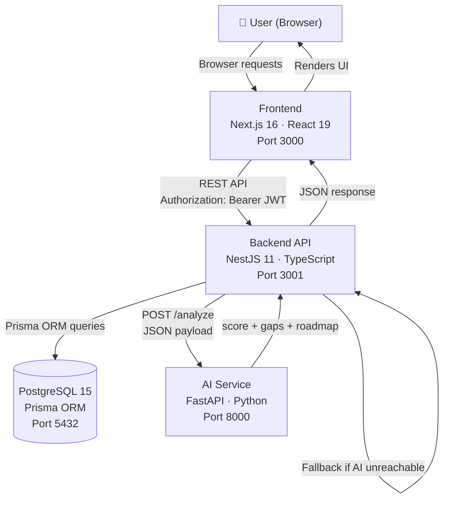

# CareerForge AI — System Architecture

This document describes the technical architecture of CareerForge AI as implemented in the source code.

---

## System Overview

CareerForge AI is a three-tier web application:

1. **Frontend** — Next.js browser application
2. **Backend** — NestJS REST API
3. **AI Service** — Python FastAPI microservice

All three services share a PostgreSQL database (accessed only by the backend) and are orchestrated via Docker Compose.

---

## Architecture Diagram



---

## Frontend Architecture

**Framework:** Next.js 16 with App Router

### Route Structure

```
/                     Landing page (public)
/auth                 Login / Registration (public)
/dashboard            Overview (protected — JWT required)
/dashboard/upload     Resume upload + role selection
/dashboard/analysis   Analysis results
/dashboard/roadmap    Learning roadmap
/dashboard/jobs       Job role matches
/dashboard/interview  Interview preparation
```

### State Management

No external state management library. State is local to components using React `useState`/`useEffect` hooks.

### Authentication State

JWT token and user object are stored in `localStorage`:
- Key `cf_token` — raw JWT string
- Key `cf_user` — JSON-serialised user object `{id, name, email, role}`

`lib/auth.ts` provides helpers: `getToken()`, `getUser()`, `setAuth()`, `clearAuth()`, `isAuthenticated()`

Dashboard routes check authentication on mount via `useEffect`. Unauthenticated users are redirected to `/auth`.

### API Communication

`lib/api.ts` — an Axios instance configured with:
- `baseURL` from `NEXT_PUBLIC_API_URL` environment variable
- Request interceptor: attaches `Authorization: Bearer <token>` header from localStorage
- Response interceptor: on `401`, clears localStorage auth and redirects to `/auth`

### Theme System

`components/ThemeProvider.tsx` provides a React Context with 10+ colour themes. Theme switching is exposed in the UI **only for admin users** (role `ADMIN` as returned by the backend). Theme preference is persisted to `localStorage`.

---

## Backend Architecture

**Framework:** NestJS 11 (modular architecture)

### Module Structure

```
AppModule
├── ConfigModule (global — loads .env)
├── PrismaModule  → PrismaService (database connection)
├── AuthModule    → AuthController, AuthService, JwtStrategy
├── ResumeModule  → ResumeController, ResumeService
└── AnalysisModule → AnalysisController, AnalysisService
```

### Authentication Flow

```
1. POST /api/auth/register
   ├── Validate DTO (class-validator)
   ├── Check email uniqueness
   ├── Hash password (bcrypt, 10 rounds)
   ├── Determine role: USER (or ADMIN if email matches ADMIN_EMAIL env var)
   ├── Save user to PostgreSQL
   └── Return JWT + user object

2. POST /api/auth/login
   ├── Find user by email
   ├── Compare password (bcrypt.compare)
   └── Return JWT + user object

3. Protected Routes
   ├── Client sends: Authorization: Bearer <token>
   ├── JwtAuthGuard → passport-jwt → JwtStrategy.validate()
   ├── JwtStrategy looks up user in DB by JWT sub (userId)
   └── Attaches user to request object (without password)
```

JWT tokens are signed with `JWT_SECRET` env var and expire after 7 days.

### Resume Processing Pipeline

```
POST /api/resume/upload (multipart/form-data)
│
├── multer FileInterceptor — receives PDF buffer
├── Validate MIME type (application/pdf only)
├── pdf-parse → extract raw text (max 20,000 chars)
├── extractSkills() — regex keyword matching against 50+ skills
│   ├── Flexible patterns (handles spacing, dots, hyphens)
│   └── Heuristic expansions (js→javascript, ts→typescript, html5→html)
└── Save {userId, fileName, rawText, parsedSkills[]} to Resume table
```

### Analysis Pipeline

```
POST /api/analysis {resumeId, targetRole}
│
├── Verify resume belongs to authenticated user
├── Prepare payload: {resume_text, extracted_skills, target_role}
│
├── TRY: HTTP POST to AI Service /analyze
│   ├── Returns: readiness_score, matched_skills, skill_gaps, roadmap
│   └── If success → use AI response
│
└── CATCH (AI unreachable or error):
    ├── Log warning: "AI Service failed — using fallback"
    ├── Local fallback algorithm:
    │   ├── Match user skills against ROLE_SKILLS database (8 roles)
    │   ├── Weighted score (core skills × 1.5, others × 1)
    │   └── generateFallbackRoadmap() with curated resource links
    └── Use fallback result
│
├── Save Analysis record to DB
├── Save Roadmap record to DB (steps as JSON)
└── Return {analysis, roadmap}
```

---

## AI Service Architecture

**Framework:** FastAPI (Python)

The AI service implements the same analysis algorithm as the backend fallback, but as a standalone HTTP service:

1. **Skill extraction** — scans `resume_text` with flexible regex against `EXTENDED_SKILLS` dictionary (30+ keywords). Uses `re.split` to handle multi-word skills with any separator.

2. **Skill normalisation** — `normalize_skill()` maps aliases to canonical names, then performs substring matching for partial matches (e.g., `postgresql` ↔ `postgres`).

3. **Role matching** — compares against `ROLE_REQUIREMENTS` map (8 roles × 8–12 required skills each).

4. **Scoring** — `floor((matched / total_required) * 100)`

5. **Roadmap** — for each skill gap, generates a step with YouTube, Coursera, and Simplilearn resource links.

---

## Database Schema

```
User
  id          String (CUID primary key)
  name        String
  email       String (unique)
  password    String (bcrypt hash)
  role        String (default: "USER")
  createdAt   DateTime
  resumes     Resume[]

Resume
  id           String (CUID)
  userId       String → User.id (cascade delete)
  fileName     String
  rawText      Text (max ~20,000 chars)
  parsedSkills String[]
  uploadedAt   DateTime
  analyses     Analysis[]

Analysis
  id              String (CUID)
  resumeId        String → Resume.id (cascade delete)
  targetRole      String
  readinessScore  Float
  extractedSkills String[]
  matchedSkills   String[]
  skillGaps       String[]
  createdAt       DateTime
  roadmap         Roadmap?

Roadmap
  id         String (CUID)
  analysisId String → Analysis.id (unique, cascade delete)
  steps      Json
  createdAt  DateTime
```

Cascade deletes are configured: deleting a User deletes all their Resumes → Analyses → Roadmaps.

---

## Data Flow — Full User Journey

```
1. User registers → Backend creates User with hashed password → Returns JWT
2. User uploads resume PDF → Backend extracts text + skills → Saves Resume
3. User selects target role → Backend calls AI service → Gets score + gaps + roadmap
4. Backend saves Analysis + Roadmap → Returns to frontend
5. Frontend renders: readiness score, matched skills, skill gaps, roadmap steps
6. User navigates dashboard to review all historical analyses
```

---

## Security Architecture

| Concern | Implementation |
|---|---|
| Password storage | bcrypt hash, 10 rounds |
| Authentication | JWT Bearer tokens, 7-day expiry |
| Authorization | NestJS JwtAuthGuard on all protected routes |
| Role assignment | Server-side only via `ADMIN_EMAIL` env var |
| Input validation | NestJS ValidationPipe, whitelist + forbidNonWhitelisted |
| CORS | Configured to allow `FRONTEND_URL` env var + localhost:3000 |
| Token storage | localStorage (see security note in README) |
| File uploads | MIME type validation (PDF only) |
